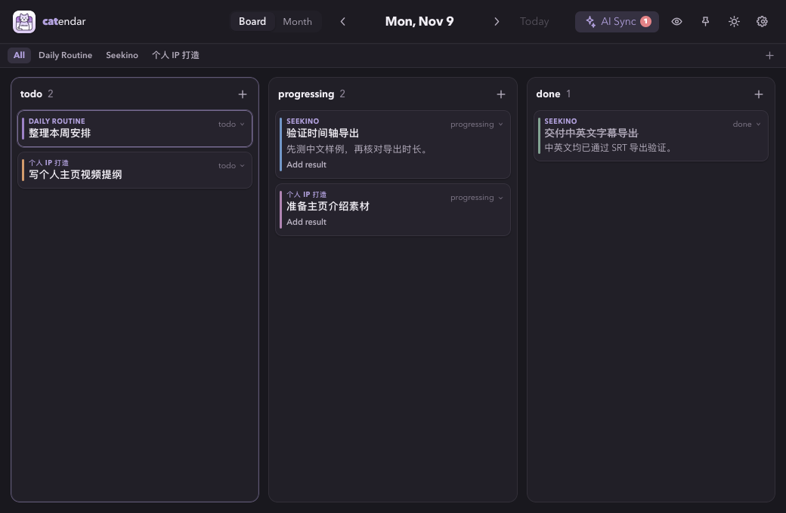

# catendar

catendar 是一个打开即显示今日看板的桌面日历。任务保存在本机的 SQLite 数据库中，也可以切换到月历查看面试、会议等有具体时间的安排。



## 功能

- 每日看板支持拖放和键盘操作，可在 `todo`、`progressing`、`done` 三个阶段之间移动任务
- 新建任务只需标题，可另填描述和截止日期
- 全天事件或带起止时间的事件
- 事件颜色、标题强调和可点击的描述链接
- 单日侧栏，以及可切换左右位置的侧栏
- `100%–150%` 日历缩放；缩放后可滚动或右键拖动画布
- 浅色/深色主题、事件时间显隐，设置会保存在本机
- 窗口置顶、关闭后驻留系统托盘
- 项目看板和统一的 All 视图，同一张卡可以在两个视图里编辑
- 点 AI Sync 用本机 Codex 整理过去 72 小时的对话，或从设置中单独同步邮箱

## 使用

点击列头的 `+`，输入标题并按 Enter，即可继续输入下一条任务。新卡片从十种颜色中随机取色，自动配色会避开上一条刚保存的颜色。创建时点 `Details…` 可添加描述和截止日期，展开 `Calendar details` 可手动选色。拖放卡片或使用卡片上的阶段选择器可移动任务。前后箭头按天切换，`Today` 回到今天。

在 `progressing` 卡片上点 `Add result` 填写结果，之后可用 `Edit result` 补充或清空。移到 `done` 后，结果以小字显示在标题下方。移回 `progressing` 可以接着编辑。

每天按本地日期延续未完成任务。昨天的 `todo`、`progressing` 今天按原阶段出现，沿用同一张卡的 ID、描述、结果和截止日期。今天完成的任务留在今天的 `done`，明天停止延续。回看昨天可以看到当日的阶段和内容，月历保留原来的日程日期。

例如，周一开始、周五截止的任务，周二仍可继续处理。中间几天没有打开应用也能接着做。升级时会接续昨天的任务，以及原日程更早、但昨天或今天更新过的未完成卡片。

旧版事件按原日期进入 `todo`，原有时间、颜色、描述和邮件来源随任务保留。邮件同步新增的任务也进入 `todo`，再次同步同一条日程时会保留已设置的阶段。

项目栏默认选中 **All**，同屏显示当天所有项目的卡片，卡片上标有归属。选择 **Daily Routine**、**Seekino** 或 **个人 IP 打造** 即可只看该项目。项目栏右侧的 `+` 可新建看板，项目名称旁的更多按钮可修改名称和匹配提示。提示可以写仓库名、简称或项目关键词，供 Codex 归类。升级时，已有卡片归入 Daily Routine。可以在卡片详情的项目字段中重新归类。

在项目看板按 `A` 或点列头的 `+`，新卡自动归入当前项目。在 All 里快速新建的卡归入 Daily Routine，也可以点 `Details…` 选择项目。All 和项目视图共享卡片 ID，完成状态及跨日记录同步可见。

每日看板的完整交互和数据约定见 [docs/design/daily-kanban.md](docs/design/daily-kanban.md)。

## 快捷键

打开右上角齿轮里的 **Settings → Keyboard shortcuts**，点要改的键位，再按下新组合即可生效。如果组合已被占用，设置会显示对应的操作。修改会保存在本机，点 **Reset to defaults** 可恢复默认键位。[查看设置界面](docs/keyboard-shortcuts.png)

| 操作 | 快捷键 |
|---|---|
| 选左列 / 右列 | 按住 `Tab`，再按 `←` / `→` |
| 选当前列的上一张 / 下一张卡片 | `↑` / `↓` |
| 按当前列的位置选卡 | `1`–`9` 选第 1–9 张，`0` 选第 10 张 |
| 在当前列快速添加 | `A`，输入标题后按 `Enter` |
| 编辑选中卡片的描述 | `U`，在编辑器内用 `Tab` / `Shift+Tab` 切换字段和按钮 |
| 将选中卡片移到上一阶段 / 下一阶段 | macOS 用 `Option+←` / `Option+→`，Windows 和 Linux 用 `Ctrl+←` / `Ctrl+→` |
| 删除选中卡片 | `D` 打开提示，`Ctrl+D` 确认 |
| 取消删除、退出快速输入或关闭编辑器 | `Esc` |
| 前一天 / 后一天（日看板） | `←` / `→` |
| 上一个月 / 下一个月（月视图） | `←` / `→` |
| 返回今天 | `T` |
| 新建任务或月历事件 | `N` |
| 缩放日历 | `Ctrl`/`Cmd` + 滚轮 |

看板用边框标出当前列和当前卡片。卡片右侧的阶段按钮可以展开三个选项。使用默认键位时，即使选项已展开，按 `↑` / `↓` 也会收起选项并在同一列选卡。切换阶段后，选择会跟随该卡片。月历的日期格也支持键盘聚焦，点击日期可查看当天安排。

macOS 的 `Ctrl+←` / `Ctrl+→` 可以继续切换桌面空间。升级时，catendar 会把原来的默认阶段键换成 `Option` 组合。如果你已改键，或对应的 `Option` 组合已分配给其他操作，会保留你的配置。[Apple 的空间切换说明](https://support.apple.com/zh-sg/guide/mac-help/mh14112/mac)

## 技术栈

- Wails 2.12
- Go 1.24
- Vue 3、TypeScript、Pinia、Naive UI、Vite
- SQLite（`go-sqlite3`）

仓库只保留一套 Wails 主线。旧 Electron 前端、Echo REST 服务及其重复依赖已经移除。

## 本地开发

先安装 Go、Node.js、平台所需的 C 编译工具和 Wails CLI，然后执行：

```bash
cd frontend
npm ci
cd ..
wails dev
```

只预览前端布局时可以运行：

```bash
cd frontend
npm run dev
```

纯浏览器预览没有 Wails IPC，因此可以浏览界面和打开表单，但不会写入事件。

## AI Sync

### Codex 对话 → 今日看板

点工具栏的 **AI Sync**，catendar 通过已登录的本机 Codex 读取过去 **72 小时**内交互会话中的用户消息和助手最终回复，整理到**本地日期的今天**。打开应用、切换看板、查看设置都不会触发读取。这个入口独立于邮箱配置。若未找到 Codex，可在 **Settings → AI Sync → Codex conversations** 填写可执行文件的绝对路径。[Codex App Server](https://developers.openai.com/codex/app-server/) · [Codex 非交互运行](https://developers.openai.com/codex/noninteractive/)

| 对话中的证据 | 看板阶段 |
|---|---|
| 明确约定要做，尚未开始 | `todo` |
| 已经开始，并有具体进展 | `progressing`，可以附上阶段成果 |
| 明确完成，能说出交付物或结果 | `done`，结果显示在标题下 |

整理器会参考项目名、匹配提示和今天的已有卡片。明确的更新会自动写入，来源引用和会话名可在同步面板查看。遇到手动编辑冲突、阶段回退或归属不清，先显示待确认项。点击 **Apply** 接受这项变更，或用 **Keep current** 保留原卡。一次同步可取消，再次点击会从已处理的消息接着整理。没有新增内容时会跳过模型调用。[查看冲突确认面板](docs/conversation-review.png)

### 邮箱 → 日历

邮件同步包含三层。Codex 和 Claude Code 使用各自的本地启动适配器。

1. `core/email` 在 Go Core 内连接邮箱，读取最近 30 天邮件；邮箱密码或应用专用密码不会交给 Agent。
2. `core/ai_sync/cli` 将本次同步允许使用的邮件读取、日历查询和批量写入能力封装成统一的 catendar CLI。
3. `core/ai_sync/agent` 自动启动用户选择的 Codex 或 Claude Code，并给两者同一份任务约束和同一套 CLI。

在 **Settings → AI Sync** 的邮箱区域中配置。

- 配置一个 IMAP 邮箱账户并测试连接；首版支持通用 IMAP，内置 QQ、Gmail、Outlook 和 iCloud 参数预设。
- 选择 Codex 或 Claude Code。catendar 会自动探测本机命令，也可以填写可执行文件的绝对路径。
- 点击 **Sync email** 读取邮件并开始整理。

QQ 邮箱使用 `imap.qq.com:993` 和 TLS。需要先在 QQ 邮箱网页设置中开启 IMAP/SMTP 服务并生成授权码，然后把授权码填入 catendar 的 `Password / app authorization code`，不要填写 QQ 登录密码。

Agent 只会获得一次性、本次运行有效的 catendar CLI 会话。它不能读取邮箱凭据，也不能任意访问 catendar 数据库；日历写入由 Go Core 校验、去重并执行。邮件生成的事件会在描述中包含 `catendar://email/...` 来源链接，点击后由应用重新读取并展示原邮件。邮件同步创建的任务默认进入 `todo`；同一来源的任务即使已经被移动到其他日期，重复同步也会跳过而不会重建或覆盖。

每次同步最多列出最近 30 天的 200 封邮件。列表只暴露邮件 ID、Message-ID、主题、发件人、邮箱服务器收件时间 `receivedAt`、发件头时间 `sentAt` 和内部来源链接；Agent 再按候选批量读取正文，每次最多 20 封，可以继续分批读取。正文会清理为纯文本并限制为每封 256 KiB，附件不会交给 Agent。单封邮件解析失败会以 `readError` 返回，不再中断整批同步。

两种 Agent 共用一份高召回筛选和时间推导规则：面试、笔试、会议、截止日期等强信号邮件必须读取正文；“收到后”等相对时间以 `receivedAt` 为锚点，明确写“发送后”时才使用 `sentAt`。最终仍只写入有邮件证据且能确定或计算日期的事件。

catendar CLI 是 Agent 使用的内部能力界面；它仅在 AI Sync 启动的受控会话中可用：

```text
catendar cli email list --cursor 0 --limit 50
catendar cli email read --ids <email-id>[,<email-id>]
catendar cli calendar list --from 2026-09-01 --to 2026-10-01
catendar cli calendar batch-upsert --input events.json
```

## 构建

```bash
wails build
```

Wails 会先执行前端类型检查与 Vite 构建，再将 `frontend/dist` 嵌入可执行文件。产物位于 `build/bin/`，不会提交到 Git。

单独验证两端时：

```bash
cd frontend && npm test && npm run build
cd .. && go build ./...
```

卡片焦点和方向键的浏览器回归测试可在 `frontend` 下运行。

```bash
npx playwright-core install chromium webkit
npm run test:browser
```

## 本地数据与凭据

事件数据库保存在系统用户配置目录下的 `catendar/calendar.db`：

- Windows：`%AppData%\catendar\calendar.db`
- macOS：`~/Library/Application Support/catendar/calendar.db`
- Linux：`$XDG_CONFIG_HOME/catendar/calendar.db`，未设置时通常为 `~/.config/catendar/calendar.db`

升级时会整体重命名旧版的 `CATendar` 目录，数据库和 SQLite 日志会一起迁移。若磁盘上已存在两个独立目录，应用使用已有数据库的目录；两边都有数据库时优先使用小写目录。

SQLite 保存任务、邮箱账户配置和 AI Provider 设置。邮箱密码保存在系统钥匙串中。升级后可以继续读取旧版 `CATendar` 服务下的凭据，重新保存密码时会写入小写 `catendar` 服务。

## 目录结构

```text
.
├── main.go                       # 进程入口、Wails 启动、CLI 模式分流和数据目录迁移
├── app.go                        # 日历能力的 Wails 适配层
├── ai_sync_app.go                # AI Sync 的 Wails 适配层
├── tray*.go                      # 系统托盘平台实现
├── core/                         # 不依赖 UI 的 Go Core
│   ├── core.go                   # 组装数据库、日历、邮箱和 AI Sync 服务
│   ├── database.go               # SQLite 初始化、迁移和数据目录迁移
│   ├── calendar/                 # 日历 CRUD、阶段、截止日期、批量写入、去重和冲突检查
│   ├── email/                    # 邮箱配置、系统钥匙串和 IMAP 读取
│   └── ai_sync/
│       ├── ai_sync.go            # 同步任务状态与能力编排
│       ├── session.go            # 一次性授权的本地 Core/CLI 会话
│       ├── cli/                  # 统一 catendar CLI 表现层
│       └── agent/                # Agent Runner、Prompt、Codex/Claude 适配器
├── docs/design/                  # 界面和数据设计文档
├── frontend/                     # Vue 3 界面及 Wails 生成绑定
├── build/                        # 打包图标和平台元数据
└── wails.json                    # Wails 构建配置
```
