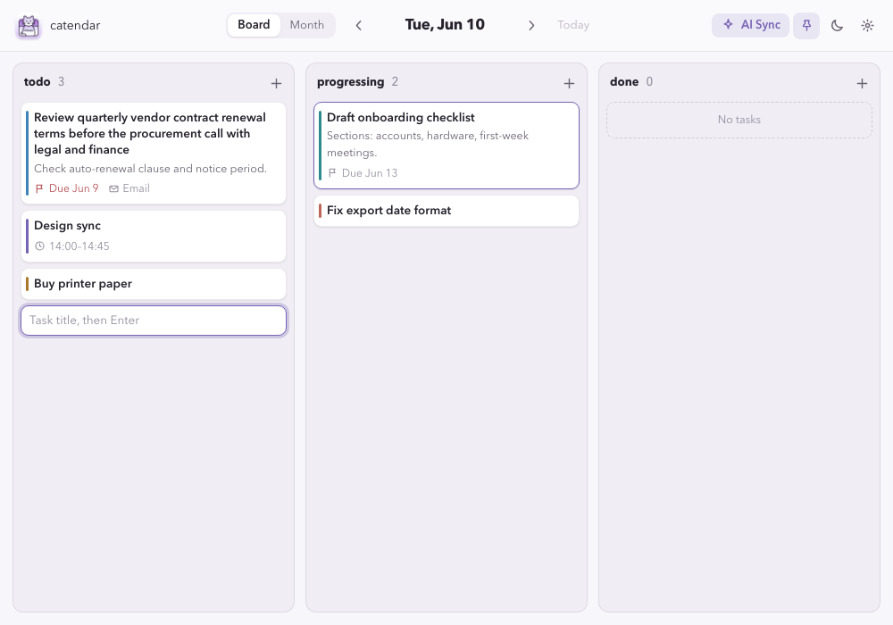

# catendar 每日看板设计

Claude Opus 5.5 基于原有桌面工具栏、字体、主题变量和事件色板绘制了[静态界面稿](daily-kanban.html)。在浏览器中打开 HTML 可查看不同窗口宽度下的布局。稿中的任务为示例。

- **从今天开始。** 打开应用进入本地当天的 Board。前后箭头切换一天，Today 回到当天。Month 共用当前日期和同一组任务，方便查看整月的时间安排。
- **阶段用位置表示。** 三列固定为 todo、progressing、done。列头显示任务数和添加入口。卡片左侧的色条沿用原事件颜色，完成的标题加删除线，拖动时高亮目标列。
- **日程与跨日延续。** 月历保留原日程。昨天未完成的卡片按原阶段延续到今天，历史看板保留当日内容。卡片仍显示原事件时间，截止日期用旗标标出。
- **允许只记一个标题。** 列头加号打开快速输入，Enter 保存，Esc 退出。点击卡片或按 Enter 打开编辑器，可修改标题、描述、截止日期和阶段。删除需要确认。
- **阶段可以双向切换。** 拖放适合用鼠标快速整理，也可通过可聚焦的阶段选择控件完成全部移动。标题换行，描述预览限两行，完整内容在编辑器中阅读。
- **适应桌面小窗。** 宽屏三列并排，窄屏纵向排列，让每张卡片保有可读宽度。空列保留添加入口，加载失败时提供重试。深浅主题共用现有颜色变量。
